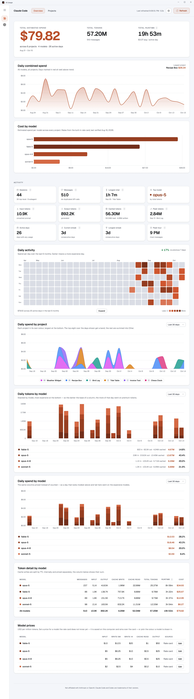

# AI Usage (native)

[](https://github.com/naimulnashid/ai-usage-native/actions/workflows/ci.yml)
[](https://github.com/naimulnashid/ai-usage-native/releases/latest)
[](LICENSE)
[](https://ai-usage-native-site.vercel.app/)

A native Windows app that shows how much **Claude Code** and **Codex** you use:
tokens, estimated cost and approximate runtime, overall, per project and per
day. It reads the agents' own transcript files on this PC. Nothing leaves the
machine: no network calls, no server, no account.

Built with WinUI 3 on .NET 10. A native port of the
[AI Usage Dashboard](https://github.com/naimulnashid/ai-usage-tracker) web app,
sharing its design and its parsing rules but no code.


<details>
<summary><b>The light theme, the projects page, and Codex</b></summary>

A light theme sits beside the dark one - **Settings > Theme** picks Dark,
Light, or the Windows setting.



Projects open with a share-of-spend ring, because a ranked list looks the same
whether the top project is 60% of your spend or 15%. Each project is drawn in
its own colour - its logo's, or one you pick - and a slice opens it.


Codex gets its own accent, and its headline says **API-equivalent spend**, not
"total spend": it is commonly used on a flat subscription, where these tokens
were never billed individually.


</details>

> **Every number in those images is invented.** They are captured from the
> synthetic transcripts `demo-data` writes (see [Development](#development)).
> A real screenshot of this app would be a screenshot of somebody's projects,
> paths and spending.

## Download

Get `AIUsage-<version>-win-x64.zip` from the
[latest release](https://github.com/naimulnashid/ai-usage-native/releases/latest),
unzip it anywhere, and run **`AIUsage.exe`** in the `AI Usage` folder. It
carries its own .NET and Windows App SDK runtime, so nothing else needs
installing. Windows 10 1809 or later, x64.

The build is not code-signed, so SmartScreen will say it does not recognise the
app: **More info → Run anyway**.

**Smart App Control** blocks it outright when it is **On**: it lets an unsigned
app run only if Microsoft's app intelligence already rates it safe, and today it
does not rate this one. Building it yourself does not get round this, since your own build is
unsigned too. To run the app, turn Smart App Control off in **Windows Security
→ App & browser control → Smart App Control**. Since the April 2026 Windows 11
update it can be turned back on later; on older builds, turning it off could
only be undone by resetting Windows. With it on **Evaluation** or **Off**,
nothing extra is needed. Signing is being considered.

## Build and install from source

Needs the [.NET 10 SDK](https://dotnet.microsoft.com/download) to build
(Visual Studio is not needed) and [Git](https://git-scm.com/download/win) to
get the source. In PowerShell:

```powershell
git clone https://github.com/naimulnashid/ai-usage-native.git
cd ai-usage-native
powershell -ExecutionPolicy Bypass -File tools\Install.ps1
```

Without Git, use **Code → Download ZIP** on the repository page instead, unzip
it, and run the last line from the unzipped folder.

**Keep the folder's path short**, under about 100 characters (`C:\src` is
fine): the build writes files up to 150 characters deep inside it, and a
longer path runs into Windows' 260-character limit and fails with "Could not
find file".

That publishes a self-contained build to `%LOCALAPPDATA%\Programs\AI Usage`,
adds **AI Usage** to the Start menu, and lists it under **Settings → Apps →
Installed apps** (and Control Panel's Programs and Features). The installed app
carries its own .NET and Windows App SDK runtime (~190 MB), so it needs neither
installed. Run the same command again to update.

**To uninstall**, use **Uninstall** on its entry in Installed apps, or run
`tools\Install.ps1 -Uninstall`. Either way your settings, archive and logos in
`%LOCALAPPDATA%\AI Usage Native` are kept; add `-RemoveData` to the script to
remove them too. The zip download is not installed at all: exit it from the
tray and delete its folder.

Windows 10 1809 or later, x64. Built and tested on Windows 11. The build is
unsigned, so Smart App Control blocks it the same way it blocks the download
(see [Download](#download)).

## Using it

- **Sidebar**: switch between Claude Code and Codex. **Top bar**: Overview and
  Projects, Refresh (or F5), and Settings.
- **Zoom** like a browser: **Ctrl+Plus** / **Ctrl+Minus**, **Ctrl+mouse wheel**,
  and **Ctrl+0** to reset, from 50% to 200%. The page reflows rather than
  scrolling sideways, and the level is remembered. The same commands are in the
  Settings menu.
- **The tray icon** shows today's spend for each agent. Closing the window
  keeps the app there; right-click the icon to exit.
- **Refresh when transcripts change** is on by default: while an agent is
  writing, its numbers update at most once a minute.
- **Start at login** is in Settings and in the tray menu. It starts straight to
  the tray.
- **Project logos**: in a project's ⋯ menu choose **Set logo…**, or drag an
  image onto its card. SVG, PNG, JPG, WebP, GIF, BMP and ICO all work. Logos
  live in `%LOCALAPPDATA%\AI Usage Native\project-logos\<agent>\`, one file per
  project named after it (`My App.svg`); dropping files there works too, and
  **Import project logos…** copies in a whole folder.
- **Hide from project list** (⋯ menu) hides a project from the list only. Its
  spend still counts in every total and chart.
- **Rename…** (⋯ menu) changes the name a project is shown under. Only the
  label changes - the folder is left alone - and logos are matched by the new
  name. **Reset** goes back to the folder's name.
- **Merge into…** (⋯ menu) counts one project as part of another - a folder
  that moved, or a private and a public copy of the same work. Its spend,
  sessions and history join the chosen project under that project's name; no
  total changes. **Unmerge**, in the merged project's menu, separates them
  again, except for days whose transcripts are already gone.
- **Project colours**: the charts split by project (the Projects page's donut
  and the overview's Daily spend by project) draw each project in its own
  colour - the one you pick with **Change colour…** in its ⋯ menu (a colour
  picker with a hex field), else its logo's dominant colour with the logo's
  background left out, else one from a fixed palette. Click a donut slice or a
  legend row to open that project.
- **Daily spend by project**, after the heat map on the overview: spend stacked
  by project over the last 30 days, the last 90, or every day on record.
- **Theme**: **Settings → Theme** picks Dark (the default), Light, or the
  Windows setting.
- **Model prices**, the last panel on the overview, lists
  each model's rate. **Set price** (or **Edit**) gives a model the rate card
  does not know yet a price of its own: it wins over the card, and every figure
  is recomputed with it, archived days included. The same editor renames the
  model everywhere it is shown and picks its colour from shades of the agent's
  accent. Drag a row by its handle to reorder the table; **Default order** puts
  the dearest first again.
- **A project page** has the overview's sections in the overview's order, for
  that project - without the third row of activity cards and the price table,
  and with its stacked charts opening on every day - followed by a
  day-by-model table.

## Settings files

Everything the app writes is in `%LOCALAPPDATA%\AI Usage Native\`
(**Settings → Open settings folder**):

| File | What |
|---|---|
| `config\settings.json` | `localUtcOffsetHours`, `weekStartsOn` (`monday`/`sunday`/`saturday`), `maxIdleGapMinutes` |
| `config\projects.json`, `config\codex-projects.json` | `merge` a renamed folder's history into its new name; `displayNames` |
| `config\pricing.json`, `config\codex-pricing.json` | a rate card that replaces the built-in one |
| `model-settings.json`, `codex-model-settings.json` | prices, colours and names set in the Model prices table, and its row order |
| `project-colors.json`, `codex-project-colors.json` | colours picked for projects with **Change colour…** |
| `project-settings.json`, `codex-project-settings.json` | merges and names set with **Merge into…** and **Rename…**; for one project they win over `projects.json` |
| `history\` | the daily archive that keeps days after the agents delete their transcripts |

Every key is optional. Refresh after editing.

## The two cost figures mean different things

| Agent | Headline | Meaning |
|---|---|---|
| Claude Code | Total estimated spend | Tokens priced at Anthropic's per-token API rates |
| Codex | API-equivalent spend | What these tokens would cost through the OpenAI API. On a ChatGPT subscription this is not what you paid. |

Do not add the two together.

## Caveats

- **Estimates, not bills.** Rates come from the built-in rate cards; the Cost
  by model panel says when each was last verified. A model missing from the
  card is flagged as unpriced, never counted as free, until you set its price.
  Claude Code's `<synthetic>` placeholder (a turn with no API call) is not
  counted as a model or a message.
- **Runtime is approximate**: the sum of gaps between transcript lines, with
  gaps over 30 minutes treated as time away.
- **Codex fast mode** doubles API rates and is not recorded in the
  transcripts, so heavy fast-mode use would cost more than shown.
- **Codex long prompts are priced as OpenAI bills them.** On the models whose
  card entry has a `longContext` tier, a request whose prompt is over 272K
  tokens costs 2x the input and cache rates and 1.5x output; each request is
  checked on its own. Cache-write rates are on the card too, though Codex has
  not logged a cache write so far.

## Development

```powershell
dotnet build AIUsageNative.slnx
dotnet test --project tests\UsageCore.Tests\UsageCore.Tests.csproj
dotnet run --project src\UsageCli -- parse claude     # diagnostics and totals; or codex
dotnet run --project src\UsageCli -- demo-data         # synthetic transcripts for both agents
```

`demo-data` prints three environment variables that point the app at the
invented transcripts. **Set all three**, including `AIUSAGE_DATA_DIR`, or the
invented days are merged into your real archive. A copy pointed at its own
data folder runs beside the one in your tray.

| Script | Does |
|---|---|
| `tools\Capture-Views.ps1` | Screenshots any page, at any scroll offset or top to bottom, on the demo data |
| `tools\Capture-Readme.ps1` | Regenerates the screenshots above, in both themes |
| `node site/build.mjs` | Builds the project site into `site/dist/` (see [site/README.md](site/README.md)) |
| `tools\Package-Release.ps1` | Builds the release zip |
| `dotnet run tools/make-social-preview.cs` | Redraws `.github/social-preview.png` |
| `dotnet run tools/make-icon.cs` | Rebuilds `app.ico` from `app-icon.svg` |

Issues are welcome; see [CONTRIBUTING.md](CONTRIBUTING.md), and report
security problems privately as [SECURITY.md](SECURITY.md) describes.

## License

[MIT](LICENSE), except for the third-party material below.

## Trademarks

Claude and Claude Code are trademarks of Anthropic. Codex and ChatGPT are
trademarks of OpenAI. Their marks in `src/UsageApp/Assets/AgentMarks` are the
vendors' own files, unmodified. This project is not affiliated with or endorsed
by either. Geist is © Vercel, under the SIL Open Font License
(`src/UsageApp/Assets/Fonts/OFL.txt`).
