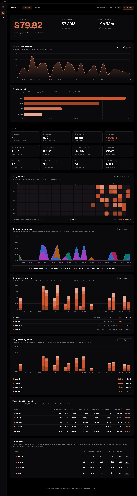
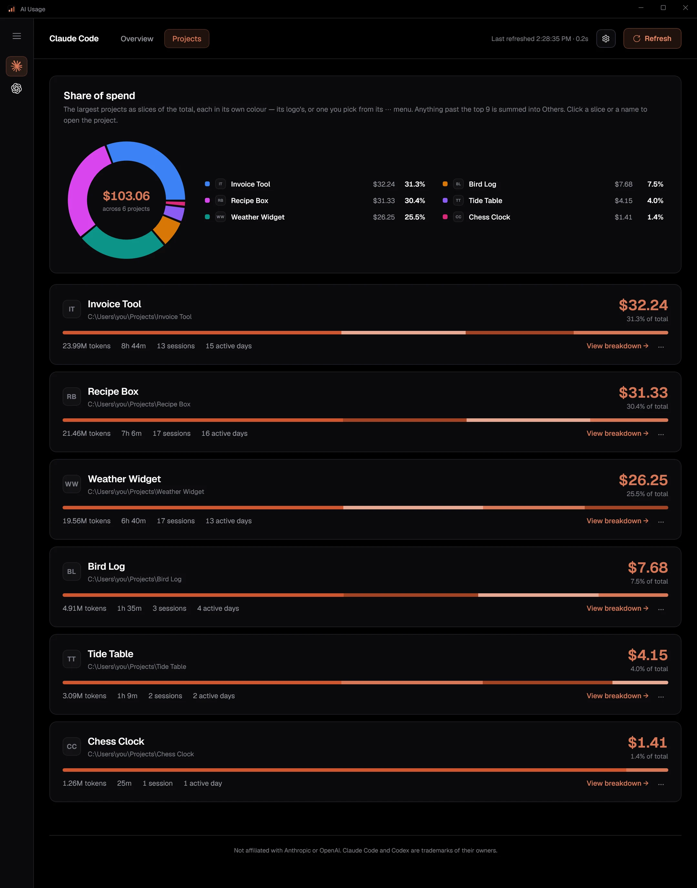
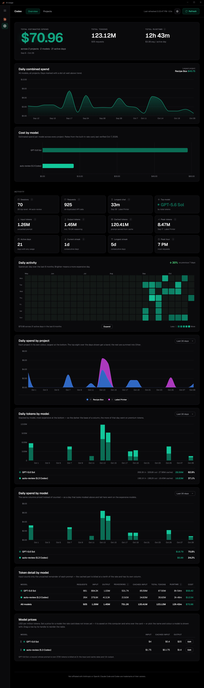
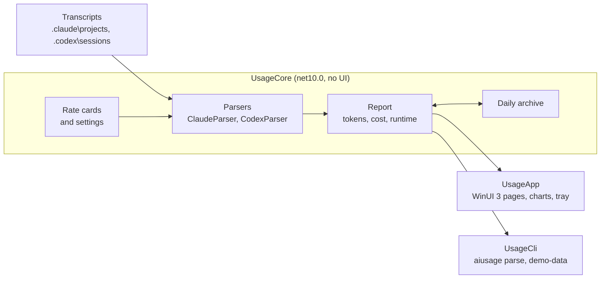

#  AI Usage (native)

[](https://github.com/naimulnashid/ai-usage-native/actions/workflows/ci.yml)
[](https://github.com/naimulnashid/ai-usage-native/releases/latest)
[](LICENSE)
[](https://ai-usage-native-site.vercel.app/)

A native Windows app that shows how much **Claude Code** and **Codex** you use:
tokens, estimated cost and approximate runtime, overall, per project and per
day. It reads the agents' own transcript files on your PC, and nothing leaves
the machine.

## Screenshots

<picture>
  <source media="(prefers-color-scheme: light)" srcset="docs/screenshots/overview-claude-light.webp">
  
</picture>

<details>
<summary><b>The projects page, and Codex</b></summary>

Projects open with a share-of-spend ring, because a ranked list looks the same
whether the top project is 60% of your spend or 15%. Each project is drawn in
its own colour - its logo's, or one you pick - and a slice opens it.

<picture>
  <source media="(prefers-color-scheme: light)" srcset="docs/screenshots/projects-claude-light.webp">
  
</picture>

Codex gets its own accent, and its headline says **API-equivalent spend**, not
"total spend": it is commonly used on a flat subscription, where these tokens
were never billed individually.

<picture>
  <source media="(prefers-color-scheme: light)" srcset="docs/screenshots/overview-codex-light.webp">
  
</picture>

</details>

The images follow GitHub's theme: dark or light, as the app draws them.

> **Every number in those images is invented.** `tools\Capture-Readme.ps1`
> writes synthetic transcripts and captures each page from them, in both
> themes (see [Development](#development)). A real screenshot of this app would
> be a screenshot of somebody's projects, paths and spending.

## Features

- **Both agents, side by side**: Claude Code and Codex, each with its own
  pages, accent and cost label.
- **Tokens, estimated cost and runtime** overall, per project, per day and per
  model, with input, output, cache writes, cache reads and (for Codex)
  reasoning tokens kept apart.
- **Counts each message once.** Claude Code writes the same message to disk
  several times (streaming updates, resumed sessions), and Codex repeats its
  running totals; both are collapsed, so cost is not overstated.
- **Built-in rate cards** for both vendors, including Claude Code's two cache
  lifetimes and Codex's higher rate for prompts over 272K tokens. A model the
  card does not know is flagged as unpriced, never counted as free, and can be
  given a price in the app.
- **History that outlives the transcripts.** Both agents delete old transcript
  files (Claude Code after 30 days by default); the app keeps a daily archive
  of the numbers, so past days do not vanish from the totals.
- **Charts**: daily spend with unusual days marked, cost by model, a six-month
  heat map, daily spend by project, daily tokens and spend stacked by model,
  and a share-of-spend ring on the Projects page.
- **Projects**: rename, merge, hide, a logo and a colour for each, and a page
  per project with its own charts and a day-by-model table.
- **Model prices**: set a price, a display name and a colour for any model,
  and drag the table into your own order.
- **Lives in the tray** with today's spend for each agent, refreshes itself
  when transcripts change, and can start at login.
- **Dark and light themes** (or follow Windows), and page zoom from 50% to
  200%.

## Installation and getting started

### Download

Windows 10 version 2004 or later, x64. Both downloads carry their own .NET and
Windows App SDK runtime, so nothing else needs installing.

**Install (recommended):** get `AIUsage-<version>-win-x64-setup.exe` from the
[latest release](https://github.com/naimulnashid/ai-usage-native/releases/latest)
and run it. It installs for your Windows account only, so it needs no
administrator rights: the app goes to `%LOCALAPPDATA%\Programs\AI Usage`, with
a Start menu entry and an entry under **Settings → Apps → Installed apps**. To
update, run a newer setup: it closes the running app and replaces it, and your
settings and history are kept.

**Portable:** get `AIUsage-<version>-win-x64.zip` instead, unzip it anywhere,
and run **`AIUsage.exe`** in the `AI Usage` folder. Nothing is installed: no
Start menu entry, and no Installed apps entry.

The downloads are not code-signed, so SmartScreen will say it does not
recognise the app: **More info → Run anyway**.

**Smart App Control** blocks it outright when it is **On**: it lets an unsigned
app run only if Microsoft's app intelligence already rates it safe, and today it
does not rate this one. Building it yourself does not get round this, since
your own build is unsigned too. To run the app, turn Smart App Control off in
**Windows Security → App & browser control → Smart App Control**. Since the
April 2026 Windows 11 update it can be turned back on later; on older builds,
turning it off could only be undone by resetting Windows. With it on
**Evaluation** or **Off**, nothing extra is needed. Signing is being
considered.

### Build and install from source

For contributors, or to run your own changes; to use the app, the setup above
is all you need. Needs the [.NET 10 SDK](https://dotnet.microsoft.com/download) to build
(Visual Studio is not needed) and [Git](https://git-scm.com/download/win) to
get the source. In PowerShell:

```powershell
git clone https://github.com/naimulnashid/ai-usage-native.git
cd ai-usage-native
powershell -ExecutionPolicy Bypass -File tools\Install.ps1
```

Without Git, use **Code → Download ZIP** on the repository page instead, unzip
it, and run the last line from the unzipped folder.

**Keep the folder's path short**, under about 100 characters (`C:\src` is
fine): the build writes files up to 150 characters deep inside it, and a
longer path runs into Windows' 260-character limit and fails with "Could not
find file".

That publishes a self-contained build and installs it where the setup does,
with the same Start menu and Installed apps entries; either one replaces the
other. Run the same command again to update.

Windows 10 version 2004 or later, x64. Built and tested on Windows 11. The
build is unsigned, so Smart App Control blocks it the same way it blocks the
download (see [Download](#download)).

### First run

The setup offers to open the app when it finishes; after that, open **AI
Usage** from the Start menu (or `AIUsage.exe` from the zip). It finds
the transcripts in their default folders on its own, `%USERPROFILE%\.claude\projects\`
for Claude Code and `%USERPROFILE%\.codex\sessions\` for Codex, and shows the
overview for Claude Code. Switch agents from the sidebar.

### Uninstall

Use **Uninstall** on its entry in **Settings → Apps → Installed apps**, however
it was installed (a source install can also run `tools\Install.ps1
-Uninstall`). It closes the app and removes it, its Start menu entry and its
start-at-login entry. Your settings, archive and logos are kept, in the data
folder: `%LOCALAPPDATA%\AI Usage Native`, or the folder `AIUSAGE_DATA_DIR`
names if you have set it.

To remove them too, delete that folder, or from a source checkout run
`tools\Install.ps1 -Uninstall -RemoveData`, which deletes only what the app
wrote there (the files and folders listed under
[Configuration](#configuration)), so other files in a folder you chose with
`AIUSAGE_DATA_DIR` are left alone.

The zip download is not installed at all: exit it from the tray and delete its
folder.

## Configuration

No configuration is needed: the app works with its defaults. What it does
let you change lives in `%LOCALAPPDATA%\AI Usage Native\`, or the folder
`AIUSAGE_DATA_DIR` names (**Settings → Open settings folder** opens its
`config\` folder). Most of it is written by the app itself;
the `config\` files are yours to edit:

| File | What |
|---|---|
| `config\settings.json` | `localUtcOffsetHours`, `weekStartsOn` (`monday`/`sunday`/`saturday`), `maxIdleGapMinutes` |
| `config\projects.json`, `config\codex-projects.json` | `merge` a renamed folder's history into its new name; `displayNames` |
| `config\pricing.json`, `config\codex-pricing.json` | a rate card that replaces the built-in one |
| `model-settings.json`, `codex-model-settings.json` | prices, colours and names set in the Model prices table, and its row order |
| `project-colors.json`, `codex-project-colors.json` | colours picked for projects with **Change colour…** |
| `project-settings.json`, `codex-project-settings.json` | merges and names set with **Merge into…** and **Rename…**; for one project they win over `projects.json` |
| `history\` | the daily archive that keeps days after the agents delete their transcripts |

Every key is optional. Refresh after editing. Examples with placeholder values:
[`settings.json`](docs/config-examples/settings.json) and
[`projects.json`](docs/config-examples/projects.json) (the same shape serves
`codex-projects.json`). A rate card has the shape of the built-in ones,
[`pricing.json`](src/UsageCore/Pricing/pricing.json) (Claude Code) and
[`codex-pricing.json`](src/UsageCore/Pricing/codex-pricing.json); a card in
`config\` replaces the built-in one wholesale, so to price one model, use the
Model prices table instead.

Two environment variables move the transcript folders the app reads, as they
do for the agents themselves: `CLAUDE_CONFIG_DIR` and `CODEX_HOME`.
`AIUSAGE_DATA_DIR` moves everything the app writes.

## Usage

- **Sidebar**: switch between Claude Code and Codex. **Top bar**: Overview and
  Projects, Refresh (or F5), and Settings.
- **Zoom** like a browser: **Ctrl+Plus** / **Ctrl+Minus**, **Ctrl+mouse wheel**,
  and **Ctrl+0** to reset, from 50% to 200%. The page reflows rather than
  scrolling sideways, and the level is remembered. The same commands are in the
  Settings menu.
- **The tray icon** shows today's spend for each agent. Closing the window
  keeps the app there; right-click the icon to exit.
- **Refresh when transcripts change** is on by default: while an agent is
  writing, its numbers update at most once a minute.
- **Start at login** is in Settings and in the tray menu. It starts straight to
  the tray.
- **Project logos**: in a project's ⋯ menu choose **Set logo…**, or drag an
  image onto its card. SVG, PNG, JPG, WebP, GIF, BMP and ICO all work. Logos
  live in `%LOCALAPPDATA%\AI Usage Native\project-logos\<agent>\`, one file per
  project named after it (`My App.svg`); dropping files there works too, and
  **Import project logos…** copies in a whole folder.
- **Hide from project list** (⋯ menu) hides a project from the list only. Its
  spend still counts in every total and chart.
- **Rename…** (⋯ menu) changes the name a project is shown under. Only the
  label changes - the folder is left alone - and logos are matched by the new
  name. **Reset** goes back to the folder's name.
- **Merge into…** (⋯ menu) counts one project as part of another - a folder
  that moved, or a private and a public copy of the same work. Its spend,
  sessions and history join the chosen project under that project's name; no
  total changes. **Unmerge**, in the merged project's menu, separates them
  again, except for days whose transcripts are already gone.
- **Project colours**: the charts split by project (the Projects page's donut
  and the overview's Daily spend by project) draw each project in its own
  colour - the one you pick with **Change colour…** in its ⋯ menu (a colour
  picker with a hex field), else its logo's dominant colour with the logo's
  background left out, else one from a fixed palette. Click a donut slice or a
  legend row to open that project.
- **Daily spend by project**, after the heat map on the overview: spend stacked
  by project over the last 30 days, the last 90, or every day on record.
- **Theme**: **Settings → Theme** picks Dark (the default), Light, or the
  Windows setting.
- **Model prices**, the last panel on the overview, lists
  each model's rate. **Set price** (or **Edit**) gives a model the rate card
  does not know yet a price of its own: it wins over the card, and every figure
  is recomputed with it, archived days included. The same editor renames the
  model everywhere it is shown and picks its colour from shades of the agent's
  accent. Drag a row by its handle to reorder the table; **Default order** puts
  the dearest first again.
- **A project page** has the overview's sections in the overview's order, for
  that project - without the third row of activity cards and the price table,
  and with its stacked charts opening on every day - followed by a
  day-by-model table.

### The two cost figures mean different things

| Agent | Headline | Meaning |
|---|---|---|
| Claude Code | Total estimated spend | Tokens priced at Anthropic's per-token API rates |
| Codex | API-equivalent spend | What these tokens would cost through the OpenAI API. On a ChatGPT subscription this is not what you paid. |

Do not add the two together.

### Caveats

- **Estimates, not bills.** Rates come from the built-in rate cards; the Cost
  by model panel says when each was last verified. A model missing from the
  card is flagged as unpriced, never counted as free, until you set its price.
  Claude Code's `<synthetic>` placeholder (a turn with no API call) is not
  counted as a model or a message.
- **Runtime is approximate**: the sum of gaps between transcript lines, with
  gaps over 30 minutes treated as time away.
- **Codex fast mode** doubles API rates and is not recorded in the
  transcripts, so heavy fast-mode use would cost more than shown.
- **Codex long prompts are priced as OpenAI bills them.** On the models whose
  card entry has a `longContext` tier, a request whose prompt is over 272K
  tokens costs 2x the input and cache rates and 1.5x output; each request is
  checked on its own. Cache-write rates are on the card too, though Codex has
  not logged a cache write so far.

## Tech stack and architecture

C# on .NET 10. The app is WinUI 3 (Windows App SDK), unpackaged and
self-contained. A native port of the
[AI Usage Dashboard](https://github.com/naimulnashid/ai-usage-tracker) web app,
sharing its design and its parsing rules but no code.



| Part | What it does |
|---|---|
| [`src/UsageCore`](src/UsageCore) | Reads the transcripts, prices them, keeps the archive, and does the view math. No UI, so the CLI and the tests use it as is. |
| [`src/UsageApp`](src/UsageApp) | The WinUI 3 app. Pages are built in C# from one set of element builders; charts are drawn on XAML shapes rather than a chart library. [Svg.Skia](https://github.com/wieslawsoltes/Svg.Skia) draws SVG logos, [H.NotifyIcon](https://github.com/HavenDV/H.NotifyIcon) the tray icon. |
| [`src/UsageCli`](src/UsageCli) | `aiusage parse <agent>` prints the diagnostics and totals; `aiusage demo-data` writes invented transcripts. |
| [`tests/UsageCore.Tests`](tests/UsageCore.Tests) | xUnit v3 tests for the parsers, pricing, archive and settings. Fixtures are written at run time. |
| [`installer/`](installer) | The [Inno Setup](https://jrsoftware.org/isinfo.php) script for the release's per-user setup.exe. |
| [`site/`](site) | The project site: plain HTML, CSS and JavaScript (see [site/README.md](site/README.md)). |

Numbers are recomputed from disk on every refresh. Transcript lines are
scanned as bytes, pulling out only the fields used, so a full parse stays
small in memory even when a line holds megabytes of tool output.

## Security and privacy

- **Nothing leaves the PC.** The app makes no network calls, opens no port,
  has no account and sends no telemetry. It asks for no API key, token or
  password, and stores none.
- **It reads the transcripts and never changes them.** Only the folders above
  (or `CLAUDE_CONFIG_DIR` / `CODEX_HOME`).
- **What it stores**, in `%LOCALAPPDATA%\AI Usage Native\` (or the folder
  `AIUSAGE_DATA_DIR` names): numbers (tokens,
  cost, runtime per day, project and model), project names and their working
  folder paths, your settings, and the logos you add. Never prompts, code or
  other transcript content.
- **Not encrypted.** These are plain JSON files, protected only by your Windows
  account's file permissions: any program running as you can read them. Your
  project names and paths are in them.
- **Known limitations**: the build is unsigned (see [Download](#download)), and
  the archive keeps a project's name and path after its transcripts are
  deleted, until you remove the data folder.

To report a vulnerability, see [SECURITY.md](SECURITY.md); it also says what is
in scope.

## Development

Run these in PowerShell from the repository folder (`dotnet test` needs the
`global.json` there):

```powershell
dotnet build AIUsageNative.slnx
dotnet test --project tests\UsageCore.Tests\UsageCore.Tests.csproj
dotnet run --project src\UsageCli -- parse claude     # diagnostics and totals; or codex
dotnet run --project src\UsageCli -- demo-data         # synthetic transcripts for both agents
```

`demo-data` prints three environment variables that point the app at the
invented transcripts. **Set all three**, including `AIUSAGE_DATA_DIR`, or the
invented days are merged into your real archive. A copy pointed at its own
data folder runs beside the one in your tray.

| Script | Does |
|---|---|
| `tools\Install.ps1` | Builds a Release copy and installs it for this user (see [above](#build-and-install-from-source)) |
| `tools\Package-Release.ps1` | Builds the release's setup.exe and zip into `artifacts\`. Needs [Inno Setup 6](https://jrsoftware.org/isinfo.php): `winget install --id JRSoftware.InnoSetup -e --scope user` |
| `tools\Capture-Views.ps1` | Screenshots any page, at any scroll offset or top to bottom, on the demo data |
| `tools\Capture-Readme.ps1` | Regenerates the screenshots above, in both themes |
| `node site/build.mjs` | Builds the project site into `site/dist/` (see [site/README.md](site/README.md)) |
| `dotnet run tools/make-social-preview.cs` | Redraws `.github/social-preview.png` |
| `dotnet run tools/make-icon.cs` | Rebuilds `app.ico` from `app-icon.svg` |

## Contributing, license and support

- **Contributing**: issues and small pull requests are welcome; see
  [CONTRIBUTING.md](CONTRIBUTING.md) for how, and what to leave out of a bug
  report.
- **Support**: ask questions and report bugs in the
  [issue tracker](https://github.com/naimulnashid/ai-usage-native/issues).
  Report security problems privately, as [SECURITY.md](SECURITY.md) describes.
- **License**: [MIT](LICENSE), except for the third-party material below.

### Trademarks

Claude and Claude Code are trademarks of Anthropic. Codex and ChatGPT are
trademarks of OpenAI. Their marks in `src/UsageApp/Assets/AgentMarks` are the
vendors' own files, unmodified. This project is not affiliated with or endorsed
by either. Geist is © Vercel, under the SIL Open Font License
(`src/UsageApp/Assets/Fonts/OFL.txt`).
